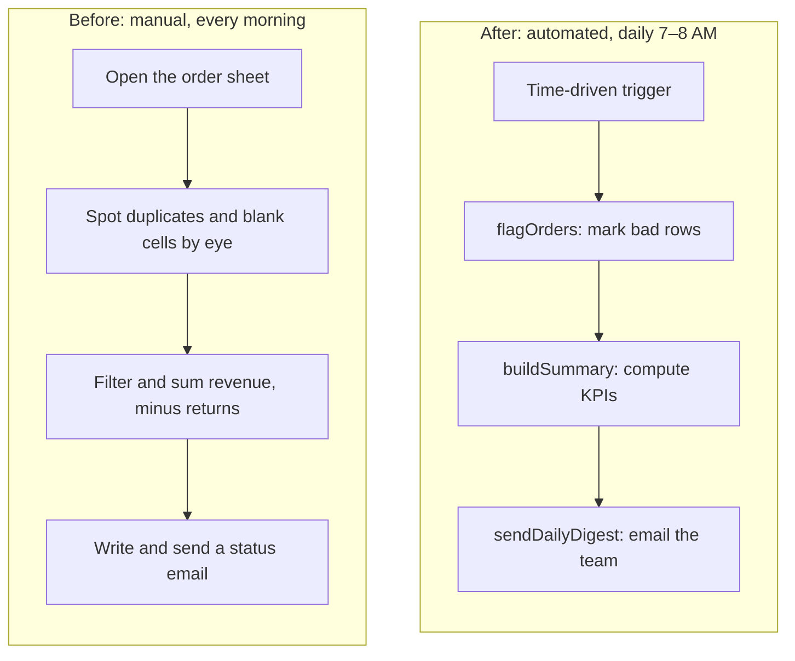
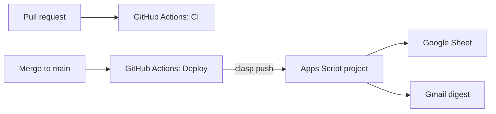
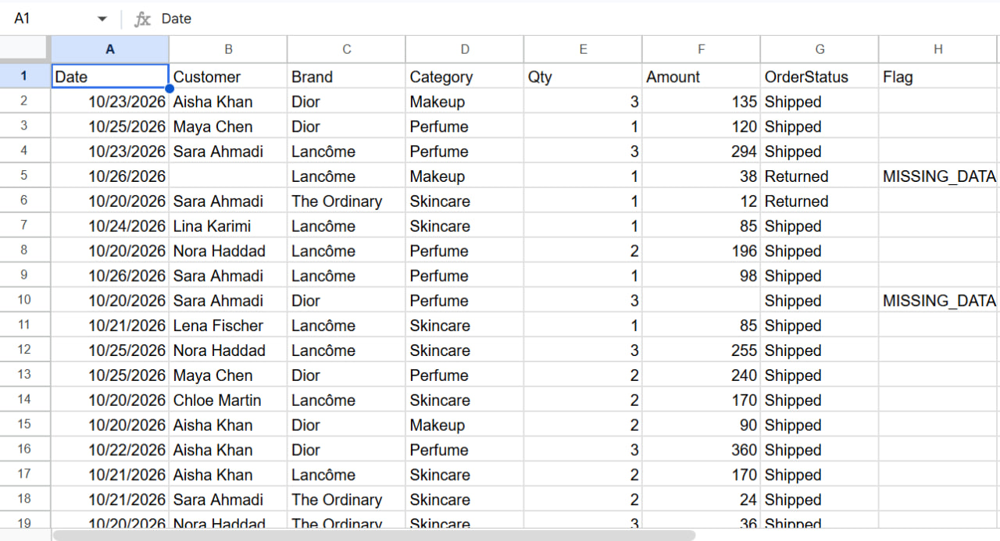
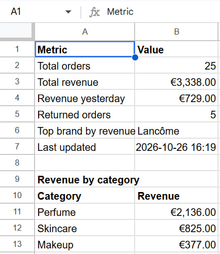
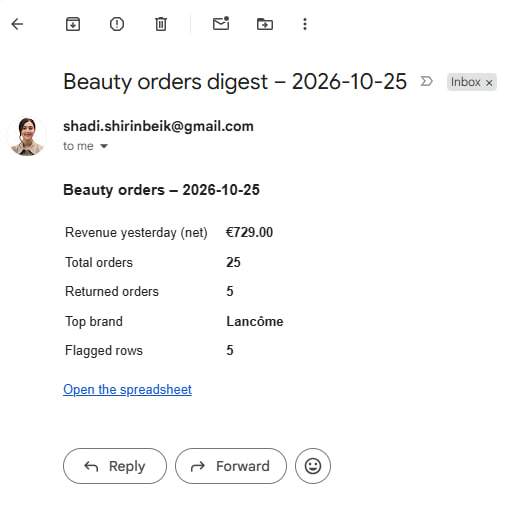
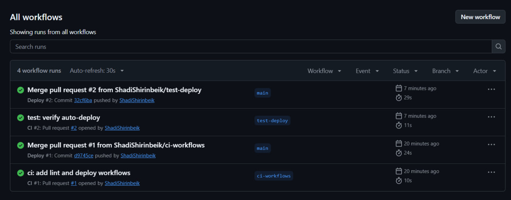

# Beauty Orders Automation

A small beauty shop tracks orders in a shared Google Sheet. Every morning someone had to scan it for duplicate and incomplete rows, total up revenue while leaving out returns, and email the numbers to the team. This project turns that routine into a Google Apps Script job. It flags bad rows, rebuilds a Summary sheet and emails a daily digest. The job runs on a time-driven trigger, and code changes are checked and deployed through GitHub Actions. The order data is mock data, generated by the script.

## Before / After

## What it does

**Flagging rules** (`flagOrders`): writes into the `Flag` column of the Orders sheet.

| Flag | Rule |
|---|---|
| `MISSING_DATA` | Customer or Amount is empty |
| `DUPLICATE` | Same Date + Customer + Brand + Amount as an earlier row (the first occurrence stays unflagged) |

Rows are flagged, never deleted. All flags are recomputed on every run, so the script can be run again safely.

**Summary KPIs** (`buildSummary`): rebuilds the Summary sheet from unflagged rows only.

| KPI | Definition |
|---|---|
| Total orders | Unflagged orders, including Returned |
| Total revenue | Sum of Amount, **excluding Returned orders** (net) |
| Revenue yesterday | Net revenue for orders dated yesterday (Europe/Berlin) |
| Returned orders | Unflagged orders with status Returned |
| Top brand by revenue | Brand with the highest net revenue |
| Revenue by category | Net revenue per category, highest first |

**Daily email digest** (`sendDailyDigest`): sends an HTML email to the script owner via Gmail. It contains yesterday's net revenue, total and returned orders, top brand, the number of flagged rows and a link to the spreadsheet.

**Time-driven trigger** (`installDailyTrigger`): schedules `runDailyPipeline` (flag → summarize → email) every day between 7 and 8 AM, Europe/Berlin time. It deletes any existing trigger for that function before creating a new one, so running it twice still leaves exactly one.

## Architecture

- **Apps Script** (V8 runtime, plain JavaScript in `Code.js`), bound to the Google Sheet.
- **clasp** (Google's CLI for Apps Script) syncs local code with the Apps Script project.
- **CI** (`.github/workflows/ci.yml`, on pull requests to `main`): runs `node --check` on every `.js` file, and fails if `.clasp.json` or `.clasprc.json` is tracked by git.
- **CD** (`.github/workflows/deploy.yml`, on push to `main`): pushes the code with clasp 3.4.1. A `concurrency` group ensures two deploys never run at once.

**Why the clasp credentials live in GitHub Secrets:** `.clasprc.json` holds an OAuth refresh token that can act on the owner's Google account. It is git-ignored, CI fails if it is ever committed, and the deploy job writes it from an encrypted secret only while the job runs.

## Screenshots

*Orders sheet: rows missing a Customer or Amount are flagged `MISSING_DATA`.*

*Summary sheet: KPIs from unflagged orders, revenue in EUR, plus revenue by category.*

*The daily digest email sent by the trigger.*

*CI on each pull request and Deploy on each merge to `main`.*

## Run it yourself

1. Install clasp (`npm install -g @google/clasp`) and enable the Apps Script API at <https://script.google.com/home/usersettings>.
2. Log in: `clasp login`.
3. Clone this repo, then either create a new Sheet with a bound script:
   `clasp create --type sheets --title "Beauty Orders" --rootDir .`
   or connect to an existing one: `clasp clone <scriptId>`.
   If clasp overwrote `appsscript.json`, restore it with `git checkout -- appsscript.json`.
4. Push the code: `clasp push --force`.
5. In the Apps Script editor, run these in order and approve the permission prompts:
   1. `seedOrders`: fills the Orders sheet with 30 mock orders, including 3 duplicates and 2 incomplete rows
   2. `flagOrders`: flags them (expected log: `{ duplicates: 3, missing: 2, clean: 25 }`)
   3. `buildSummary`: builds the Summary sheet
   4. `runDailyPipeline`: runs all three steps and sends the email
   5. `installDailyTrigger`: schedules the daily run
6. For CD, add two repository secrets (Settings → Secrets and variables → Actions):
   - `CLASPRC_JSON`: the contents of `~/.clasprc.json` (created by `clasp login`)
   - `CLASP_JSON`: the contents of `.clasp.json` (contains the script ID)

   Or with the GitHub CLI: `gh secret set CLASPRC_JSON < ~/.clasprc.json` and `gh secret set CLASP_JSON < .clasp.json`.

## Built with AI-assisted coding

I built this with Claude Code, using a `CLAUDE.md` file to set the project rules (batch reads and writes, small documented functions, a plan before every change). Claude Code proposed each step as a short plan and generated the code once I approved it, and I ran and checked every step in the real Sheet. The design decisions were mine: which rows count toward the KPIs, excluding Returned orders from net revenue, the Europe/Berlin time zone and the replace-then-create trigger strategy.

## Limitations and next steps

**Limitations**
- **clasp token expiry:** the refresh token in `CLASPRC_JSON` can be revoked or expire, for example after a password change or 6 months without use. Deploys then fail until the secret is refreshed with a new `clasp login`.
- **CI checks syntax only:** there are no unit tests for the flagging and KPI logic yet.
- **Fixed Summary layout:** the EUR format targets fixed cells (`B3:B4`), so reordering the KPI rows means updating that range too.
- **Total orders counts unflagged rows only:** this is a deliberate definition, but it differs from the raw row count on the Orders sheet.

**Next steps**
- Add a short Gemini-written summary paragraph to the digest, such as notable changes compared with the previous day.
- Connect the pipeline to [Make](https://www.make.com/) or [Vercel eve](https://vercel.com/docs/eve), to route the digest to other channels or build an agent on top of the order data.
